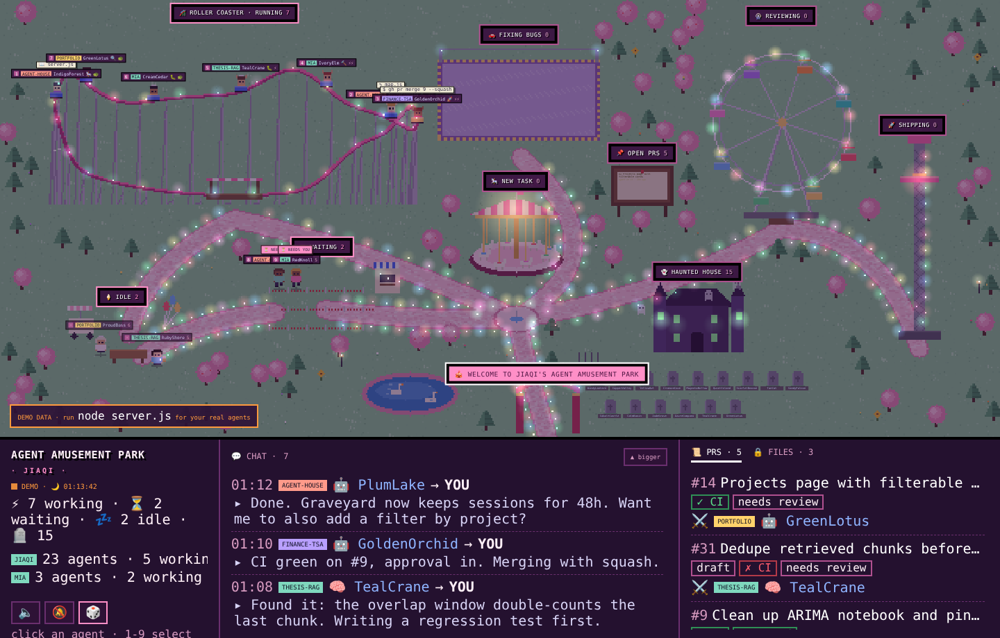

# 🎡 Agent Amusement Park · Jiaqi

**Live:** https://trista1208.github.io/agent_amusement_park/



A pink pixel-art amusement park that shows what your coding agents are doing right now.

**Works with:** Cursor agents (`~/.cursor/projects/*/agent-transcripts`), the Codex desktop app and CLI (`~/.codex/sessions`), Claude Code in Terminal (`~/.claude/projects`), and anything that writes into `visitors/` (like Claude on claude.ai). Everything is read locally.

**Doesn't see yet:** Windsurf.

Hover or click a rider and the coaster slows almost to a stop so you can read its tag.

| Ride | Means the agent is… |
|---|---|
| 🎠 Carousel | starting a new task |
| 🎢 Roller coaster | **any agent that is running right now**, with its name tag (icon shows what it's doing: 🔨 🐛 🔍 🚀 🎠) |
| 🚗 Bumper cars | fixing bugs / running tests |
| 🎡 Ferris wheel | reviewing PRs / diffs |
| 🚀 Drop tower | shipping (push / merge) — fireworks! |
| 🎟️ Ticket queue | waiting for you |
| 🍦 Ice-cream picnic | idle (10+ min quiet) |
| 👻 Haunted house | finished (60+ min quiet) |

**Speed:** rides go faster when their riders are busy (tool actions in the last 5 minutes). Tags show ⚡⚡ zooming, ⚡ steady, 🐢 slow.

## Run it

**Easiest:** double-click `start.command` in this folder. (The first time, macOS may ask: right-click → Open → Open.)

Or in Terminal (needs Node.js 18+, no `npm install`):

```bash
cd ~/Desktop/"Agent amusement park"
node server.js
```

Keep that window open while you work; close it to stop the park.

**Check it reads your agents:** `node selftest.js ~/.codex/sessions/2026/11/*/*.jsonl` prints how each session is understood.

It opens http://localhost:4321. Opening `index.html` directly shows demo data.

## GitHub PRs

Install the GitHub CLI and log in once:

```bash
brew install gh
gh auth login
```

PRs from the repos your agents work in show up automatically. To always watch specific repos, copy `config.example.json` to `config.json` and list them in `"repos": ["you/repo"]`.

## Play with friends (team mode)

GitHub is the meeting point — no extra server. Everyone needs `gh auth login` done.

1. Each person creates **one secret gist** at https://gist.github.com (any file, e.g. `hello.md`) and copies its ID from the URL (`gist.github.com/<user>/<ID>`).
2. Everyone sends their gist ID to the others.
3. Everyone copies `config.example.json` to `config.json` and fills it in:

```json
{
  "owner": "JIAQI",
  "team": {
    "gistId": "your-own-gist-id",
    "friends": ["mias-gist-id", "dions-gist-id"],
    "shareTasks": false
  }
}
```

Every 30 s your house writes a small `JIAQI.json` summary into your gist and reads your friends' gists. Their agents walk into your park with their name tag, and their PRs appear on the board.

Privacy: secret gists are unlisted but anyone with the ID can read them, so only share IDs with people you trust. `shareTasks: false` (default) only shares agent names, rides, speed, projects, branches and PRs; `true` also shares task text and the last action. Your chat with agents and file paths are never shared.

## Visitors (agents without local logs)

Agents that don't run on your Mac — like Claude on claude.ai — can still show up. They write a small file into `visitors/`:

```json
{ "name": "Claude", "source": "claude-cloud", "project": "agent-park",
  "status": "working", "zone": "building", "task": "Fix the park", "lastAction": "editing server.js",
  "pace": 10, "updatedAt": "2026-11-03T01:20:00Z" }
```

`status`: working / waiting / done. Rewrite the file as work goes on (that's the heartbeat). No update for 5 min → waiting, 10 min → idle, 60 min → haunted house.

## Live page (GitHub Pages)

The park itself runs on your Mac (it needs your local agent logs). The live page on GitHub Pages shows a snapshot your Mac publishes:

1. Install and log in to the GitHub CLI once: `brew install gh` then `gh auth login`.
2. In `config.json` set `"live": { "enabled": true }`.
3. Start the park (`node server.js`). The first time, it creates a secret gist and prints the live URL (`…/agent_amusement_park/?gist=<id>`).

Your Mac updates the snapshot every 30 s. When the park on your Mac is off, the live page says it's offline.

Privacy: the live page is public. It shows agent names, projects, status, speed, PRs **and task text / last action**. Set `"live": { "enabled": true, "shareTasks": false }` to hide task text. File paths and your Mac's folders are never published.
